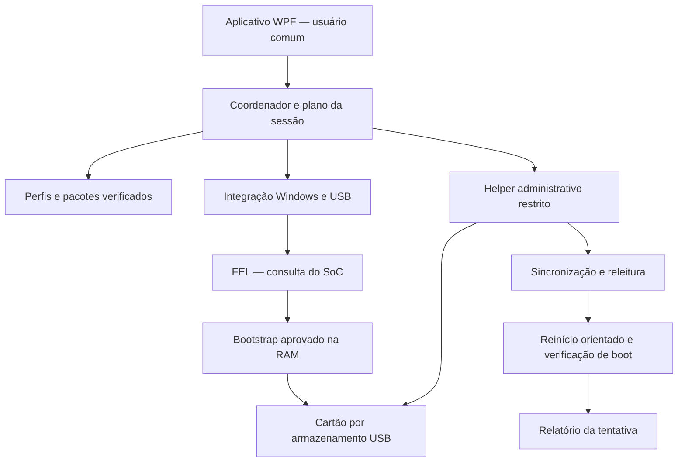

# Arquitetura proposta

## Responsabilidades e limites de confiança

O aplicativo principal funciona sem elevação. Seu núcleo mantém a sessão, interpreta evidências e prepara um plano imutável. Apenas o helper administrativo abre o disco para escrita ou prepara o driver. A integração Windows identifica os dispositivos antes e depois das mudanças de modo USB.

## Estado da instalação

O contrato de estados está em `../contracts/install-state-machine.json`. Ele distingue identificação, compatibilidade, preparação do driver, bootstrap, correlação do disco, seleção do pacote, confirmação do destino, elevação, escrita, sincronização, verificação e boot.

O estado de sucesso só é atingido depois da confirmação definida pelo pacote. “Imagem conferida, aguardando reinício” tem resultado próprio. A ausência de uma resposta do usuário ou o término de um prazo não equivalem a autorização.

A autorização de apagar vale para um plano: perfil, imagem, destino, política de dados e tentativa. Se qualquer um mudar, a interface mostra o novo plano. Não reaproveitar uma confirmação genérica em outro cartão.

## Identidade e correlação

Na passagem FEL → UMS → sistema iniciado, o dispositivo troca descritores e interfaces. O identificador de sessão do aplicativo continua o mesmo, mas a identidade Windows precisa ser correlacionada e revalidada. Coletar os dados disponíveis de caminho físico USB, ContainerId, SoC/SID, descritores e mídia. Um único identificador isolado não deve decidir uma gravação.

No protótipo, a serial UMS deriva do console, não comprova o CID do cartão. Para proteção mais forte contra troca de mídia, avaliar uma consulta de CID pelo bootstrap antes de UMS ou um protocolo de instalação próprio. A capacidade e o nome do disco não resolvem dois cartões idênticos.

## Plano administrativo

O plano conterá identificação da tentativa, perfil e digest, imagem e hash, capacidade e identidade esperadas da mídia, layout, regiões permitidas de escrita e política dos dados. O helper recusa planos incompletos, perfis sem aprovação para o canal e discos de sistema/boot. A aplicação não envia um comando PowerShell livre como operação administrativa.

Antes da primeira escrita: validar pacote, reabrir o destino, comparar a identidade e capacidade reais, bloquear/desmontar os volumes necessários e conferir que não pertencem ao sistema do PC. O helper deve vincular as operações ao handle validado e tratar reconexões como uma nova verificação.

## Pacotes e atualizações

Catálogo, assinatura e hashes têm papéis diferentes. A assinatura estabelece a origem do catálogo/pacote; o hash vincula o conteúdo exato. A chave de assinatura do catálogo não é a mesma coisa que a assinatura Authenticode do executável Windows.

Um pacote do launcher precisa declarar ABI, serviços e versão mínima da base. Um pacote de imagem define layout e efeitos sobre dados. Nada deve inferir que trocar o launcher é seguro só porque o nome do sistema continua igual.

## Falhas e retomada

O diário fica no PC, com escrita atômica de fase e progresso. Uma queda após iniciar a gravação deixa o cartão em estado incompleto. A retomada inicial mais simples é reiniciar a gravação integral do pacote validado; retomada por blocos só será oferecida depois de implementar e testar hashes por região e identidade da mídia.

Antes de uma intervenção destrutiva, explicar o que será preservado e o que será recriado. Se o cartão já estiver ilegível, o aplicativo não deve dizer que fez backup com sucesso. Interrupção de driver, desconexão e falha de releitura têm diagnósticos separados.

## Componentes externos

FEL e bootstrap podem inicialmente executar como componentes nativos externos com entrada restrita, versão fixada e integridade verificada. Avaliar migração do transporte para WinUSB em C# somente depois de reproduzir o comportamento validado, incluindo preservação das pilhas SRAM na execução de SPL.

O cliente não precisa de WSL, compilador ou Python. O helper deve ter arquitetura e assinatura compatíveis com a edição publicada. Windows ARM64 e sistemas anteriores aos homologados serão tratados como configurações separadas, não presumidos a partir do sucesso em x64.
